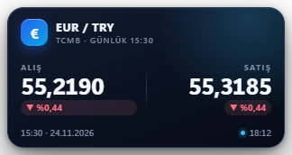

# TCMB EUR Widget



Görev çubuğunun sağ alt köşesinde, diğer pencerelerin üstünde duran küçük bir
**EUR/TRY** widget'ı. Veriyi doğrudan **TCMB**'den alır:

- **Alış / Satış:** TCMB 15:30 günlük gösterge kuru
- **Yüzde:** önceki iş gününe göre değişim (kâr/zarar)

## Özellikler

- Görev çubuğunun sağ altına hizalanan, her zaman üstte, çerçevesiz pencere
- TCMB resmî günlük EUR/TRY alış ve satış kuru
- Önceki iş gününe göre yüzde değişim (hafta sonu ve tatilleri atlar)
- 15 dakikada bir otomatik yenileme; ayrıca 15:31, 15:35 ve 15:40’ta bülten kontrolü
- Uykudan dönüşte ve gün değişiminde zorunlu tazeleme
- İnternet yoksa son iyi veriyi “eski veri” etiketiyle gösterme
- Tepsi simgesi: göster/gizle, yenile, Windows ile başlat, konumu sıfırla, çıkış
- Sürüklenebilir ve konumu hatırlanan pencere
- Harici çalışma zamanı bağımlılığı yok; yalnızca Electron

## Kullanım

```sh
npm install
npm start
```

Widget açılır açılmaz sağ altta, görev çubuğunun üstünde görünür.

- **Sürükle:** Pencereyi istediğin yere taşı. Konum hatırlanır.
- **Yenile:** Fareyle üzerine gelince çıkan ↻ düğmesi.
- **Gizle:** Üstteki − düğmesi, `Esc` veya tepsi simgesine tıklama.
- **Tepsi menüsü (sağ tık):**
  - Göster / Gizle
  - Şimdi yenile
  - Windows ile başlat (aç/kapat)
  - Konumu sıfırla
  - Çıkış

## Paketleme (kurulum gerektirmeyen exe)

```sh
npm run dist
```

Çıktı: **`dist\TcmbEurWidget.exe`** (tek dosya, ~110 MB).

## Veri ve önbellek

- Kaynak: `https://www.tcmb.gov.tr/kurlar/today.xml`
- Önceki iş günü: `https://www.tcmb.gov.tr/kurlar/YYYYMM/DDMMYYYY.xml`
- Her **15 dakikada** bir yenilenir; uygulama uykudan döndüğünde de tazelenir.
- Bülten çıkışına yakın **15:31, 15:35 ve 15:40**’ta (İstanbul saati) zorunlu
  kontrol yapılır; TCMB gecikirse sonraki 15 dakikalık tur yakalar.
- Gün değiştiğinde bir kez zorunlu yenileme yapılır.
- Son iyi veri `%APPDATA%\tcmb-eur-widget\rates.json` içinde tutulur.
  İnternet yoksa widget son veriyi **“eski veri”** etiketiyle gösterir.
- Pencere konumu `%APPDATA%\tcmb-eur-widget\window.json` içinde saklanır.

## Notlar

- TCMB'nin EUR/TRY için **anlık** resmî kuru yoktur; resmî veri günlük 15:30
  gösterge kurudur. Widget bu yüzden “Günlük 15:30” etiketiyle çalışır.
- Yüzde, önceki iş günü kapanışına göre hesaplanır (hafta sonu/tatil atlanır).
- İmzasız portable exe için Windows SmartScreen “bilinmeyen yayıncı” uyarısı
  verebilir: **Daha fazla bilgi → Yine de çalıştır**.
- Bu ekran yatırım tavsiyesi değildir.

## Lisans

[MIT](LICENSE) © 2026 miteOrhan

Veri kaynağı: [Türkiye Cumhuriyet Merkez Bankası](https://www.tcmb.gov.tr/).
TCMB verileri kendi kullanım koşullarına tabidir.
